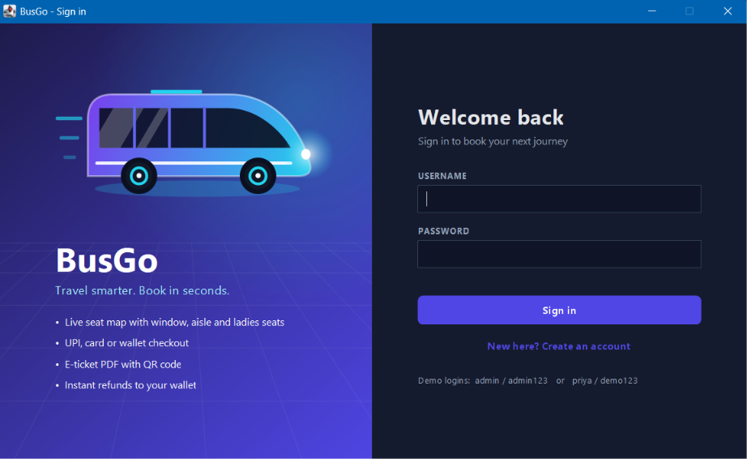
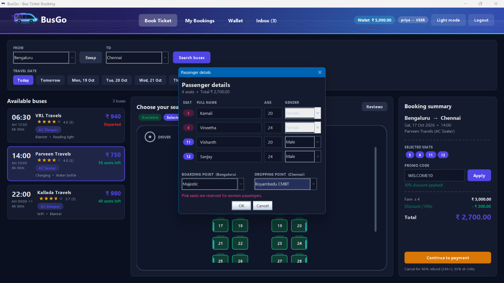
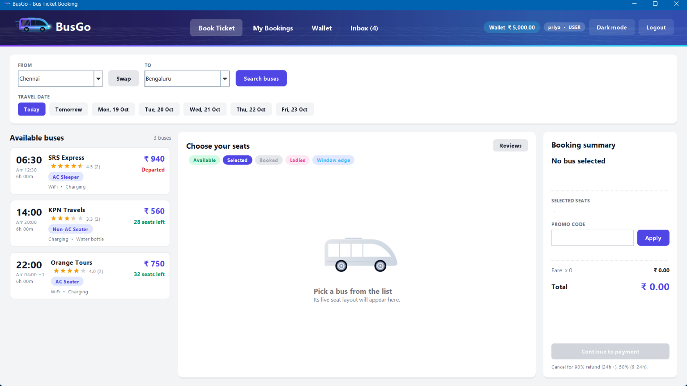
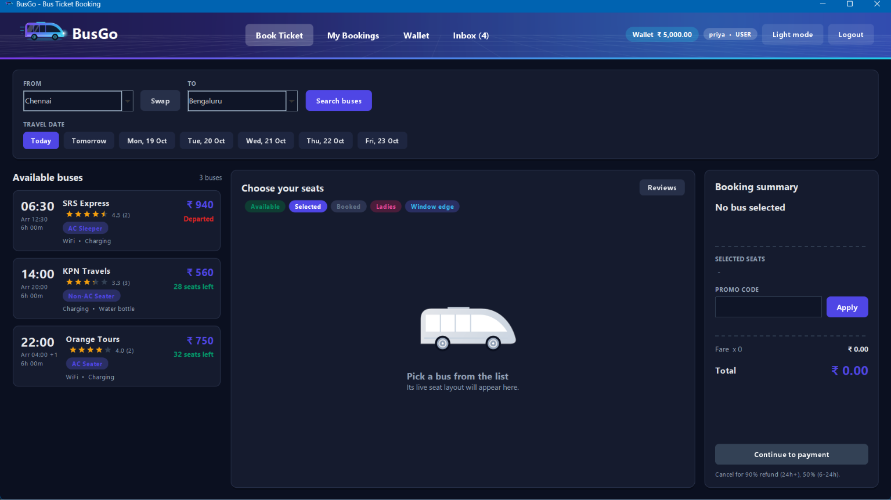
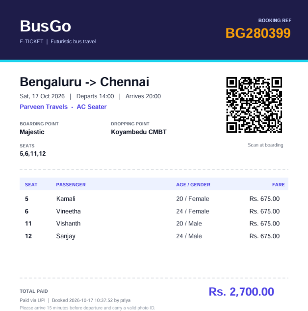
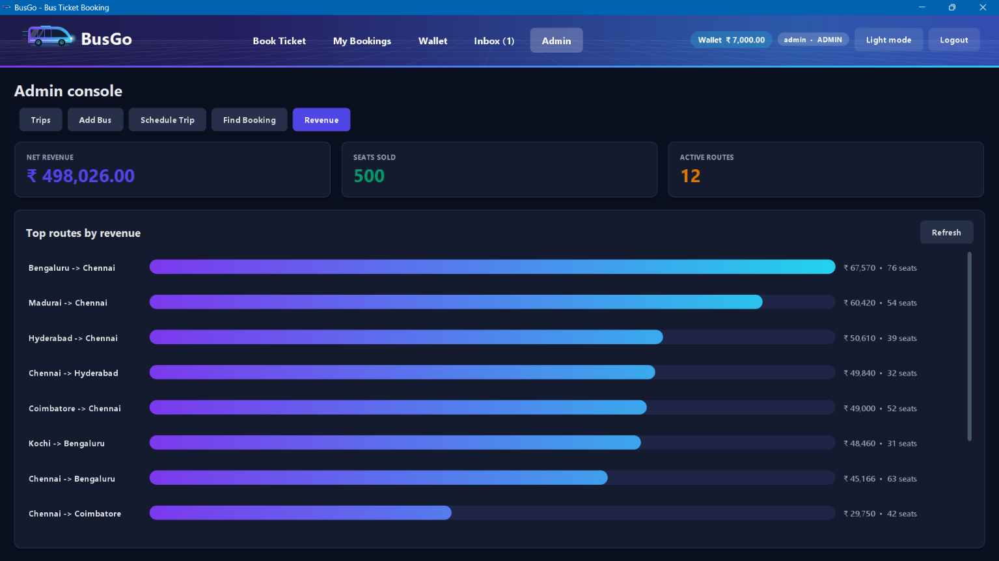

# BusGo: Bus Ticket Booking System


A desktop reservation system for intercity bus travel, built with Java Swing, JDBC and SQLite.

## Overview

BusGo covers the complete booking lifecycle: trip search, graphical seat selection, payment, e-ticketing with a QR code, cancellation with automatic refunds, and an administrative console for managing the fleet, schedules and revenue.

Booking operations run as database transactions, and the schema guarantees that the same seat can never be sold twice.

| | |
|---|---|
| **Project type** | College mini project |
| **Student** | Vishanth V |
| **Department** | Computer Application |
| **Institution** | Crescent Institute of Science and Technology |
| **Technology** | Java 17+, Swing, JDBC, SQLite |

## Screenshots

| Login | Booking and passenger details |
|---|---|
|  |  |

| Light theme | Dark theme |
|---|---|
|  |  |

| E-ticket (PDF) | Administrator console |
|---|---|
|  |  |

## Features

**Passengers**
- Trip search by city pair and date, with ratings, amenities, duration and arrival time
- Interactive seat map with booked, selected, window, aisle and women-reserved seats (up to 6 seats per booking)
- Promo codes with a live price summary
- Checkout by UPI, card (Luhn validation) or wallet
- PDF e-ticket with an embedded QR code
- Seat-level cancellation with a time-based refund credited to the wallet
- Wallet with top-up and transaction history, in-app inbox, bus ratings and reviews
- Light and dark themes

**Administrators**
- Fleet management and trip scheduling, including daily repeats
- Edit, cancel or delete trips; a cancelled trip refunds every passenger in full
- Passenger manifest per trip with CSV export
- Booking search by reference, passenger or username
- Revenue summary and a per-route revenue chart

## Architecture

```
Presentation    Swing UI       BusApp, LoginFrame, PayDialog, AdminPages, Ui
      |
Data access     JDBC           Db.java (PreparedStatement, transactions)
      |
Storage         SQLite         busgo.db
```

`Qr.java` and `Pdf.java` are self-contained utilities that generate the QR code and the PDF ticket without external libraries.

**Design decisions**
- **Layered design.** All SQL is isolated in `Db.java`. The user interface only calls its methods and receives plain Java values.
- **Transactional booking.** Seat insertion, wallet debit, wallet history and notification are committed together or rolled back together.
- **Integrity at the database level.** A partial unique index on `bookings(trip_id, seat_no)` for confirmed bookings rejects duplicate seats, even under concurrent attempts.
- **Security.** Every query is parameterised to prevent SQL injection, and passwords are stored as SHA-256 hashes.
- **Custom interface.** Components are rendered with Java 2D for a consistent look, including a theme system and animated payment states.

## Business rules

| Rule | Behaviour |
|---|---|
| Refund, cancelled 24 hours or more before departure | 90% |
| Refund, cancelled 6 to 24 hours before departure | 50% |
| Refund, cancelled less than 6 hours before departure | None |
| Refund, trip cancelled by the administrator | 100% |
| Refund destination | The passenger's wallet, credited immediately |
| Women-reserved seats | The first rows of each bus; the passenger must be female |
| Window seats | First and last seat of every row |
| Promo codes | `WELCOME10` (10%), `SAVE20` (20%), `FESTIVE15` (15%) |

## Database

The schema contains nine tables, created automatically on first run and populated with sample data (12 buses, 12 routes in both directions, 10 days of scheduled trips).

| Table | Purpose |
|---|---|
| `users` | Accounts, roles and wallet balance |
| `buses` | Fleet, seat count, women-reserved rows, amenities |
| `trips` | Scheduled journeys with date, time, duration, fare and status |
| `bookings` | One row per booked seat, with payment and refund details |
| `coupons` | Promo codes |
| `stops` | Boarding and dropping points per city |
| `reviews` | Ratings and comments (one per user per bus) |
| `notifications` | Inbox messages |
| `wallet_tx` | Wallet credits and debits |

## Getting started

**Prerequisites:** JDK 17 or later. Verify with `javac -version`.

**Windows:** run `compile.bat`, then `run.bat`.

**Linux and macOS:** run `sh compile_and_run.sh`.

**Manual build** (from the project folder; use `:` instead of `;` on Linux and macOS):

```
javac -cp ".;lib/*" Db.java Qr.java Pdf.java Ui.java PayDialog.java LoginFrame.java AdminPages.java BusApp.java
java --enable-native-access=ALL-UNNAMED -cp ".;lib/*" BusApp
```

**Demo accounts**

| Role | Username | Password |
|---|---|---|
| Administrator | `admin` | `admin123` |
| Passenger | `priya` | `demo123` |

**Payment simulation.** No real transaction takes place. Card `4111 1111 1111 1111` succeeds and `4000 0000 0000 0002` is declined, so both outcomes can be demonstrated.

## Project structure

```
BusGo-Bus-Ticket-Booking/
├── BusApp.java        Main window and application entry point
├── LoginFrame.java    Authentication
├── PayDialog.java     Checkout
├── AdminPages.java    Administrator console
├── Ui.java            Theme and custom components
├── Db.java            JDBC data access, schema and sample data
├── Qr.java            QR code generator
├── Pdf.java           PDF ticket writer
├── lib/               SQLite JDBC driver and logging libraries
├── screenshots/       Images used in this README
├── compile.bat, run.bat, compile_and_run.sh
└── README.md
```

## Limitations and roadmap

- Integrate a real payment gateway in place of the simulated checkout
- Move to MySQL or PostgreSQL with connection pooling for multi-user deployments
- Deliver tickets by email and SMS
- Add web and mobile clients, and live bus tracking

## Author

**Vishanth V**
Department of Computer Application, Crescent Institute of Science and Technology
